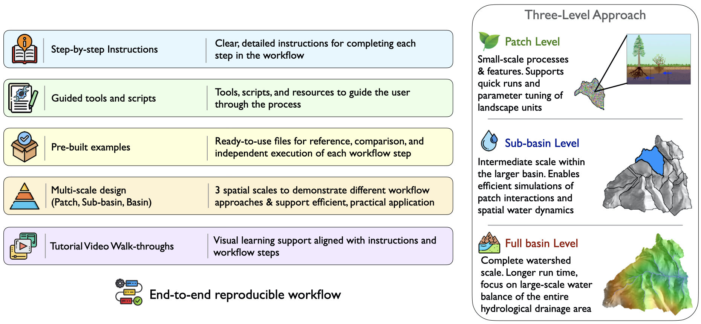

# Example Dataset (The Sandbox)

{fig-alt="Instructional System Design" width="1000"}

## Study Site Overview

The example data in this book were developed using the Sagehen Creek Watershed on the eastern slope of the northern Sierra Nevada, formally designated and managed as the Sagehen Experimental Forest by the USDA Forest Service in cooperation with the University of California, Berkeley. At roughly 27 km², it's small enough to run quickly and look at closely, but it still has real variation in elevation, aspect, soils, and vegetation. That's useful here because we'll be setting up the model at several spatial scales, from a single patch to a sub-basin to the whole watershed, to demonstrate different workflow approaches and support efficient, practical application.

Sagehen has been a research site for a long time, with an active field station and decades of streamflow, snow, climate, and vegetation data. The long streamflow and snow records give us something to calibrate against, with clear seasonal signals and a range of conditions, including wet years, dry years, and stretches in between. The mix of conifer forest, chaparral, and meadow supports landcover change scenarios and makes vegetation parameters meaningful targets for calibration and sensitivity analysis. And because the Sierra is a fire-adapted landscape, it works well for modeling fire scenarios.

## Dataset Contents

Each file type and it's purpose will be discussed in the chapters that follow as they are introduced. The files are maintained in the standard RHESSys directory structure set-up.

### Spatial Data

Spatial files are in the `Spatial_Data` directory. Information on each can be found in chapter 5 User-Acquired data, Spatial Data

| File           | Description                                                                                                                                   | Derived from                      |
|-------------------|----------------------------------|-------------------|
| `dem.tif`      | Digital elevation model downloaded from the National Elevation Dataset (NED) with the R package FedData, using landscape boundary coordinates | NED                               |
| `aspect.tif`   | Slope direction                                                                                                                               | DEM                               |
| `slope.tif`    | Slope steepness                                                                                                                               | DEM                               |
| `ehr.tif`      | East horizon angle                                                                                                                            | DEM                               |
| `whr.tif`      | West horizon angle, used for shading                                                                                                          | DEM                               |
| `streams.tif`  | Stream network                                                                                                                                | DEM                               |
| `subbasin.tif` | Subbasins within the larger basin (used to define the hillslope object)                                                                       | DEM                               |
| `basin.tif`    | Basin boundary, delineated from the stream gauge coordinates and the stream network                                                           | Gauge coordinates, stream network |
| `patch.tif`    | Patch map, the smallest spatial unit in the model. Patch IDs are assigned to DEM cells according to the selected patch method                 | DEM                               |
| `asprules.txt` | Reclassification of a landcover map to correspond with a aspatial rules file                                                                  | NLCD landcover map                |

### Climate Data

Climate files are in the `climate` directory and come in two parts: the meteorological data and the base station files that link them to the worldfile.

#### Meteorological data

Information on each can be found in chapter 5 User-Acquired data, Climate Data

| Variable            | Gridded product (NetCDF) | Local station data              |
|-------------------|-----------------------|------------------------------|
| Precipitation       | `sagehen_precip.nc`      | `sagehen.rain`                  |
| Minimum Temperature | `sagehen_tmin.nc`        | `sagehen.tmin`                  |
| Maximum Temperature | `sagehen_tmax.nc`        | `sagehen.tmax`                  |
| Wind                | `sagehen_wind.nc`        | `sagehen.wind`                  |
| Relative humidity   | `sagehen_rh.nc`          | `sagehen.relative_humidity`     |
| Rain duration       | `sagehen_raindur.nc`     | `sagehen.daytime_rain_duration` |

#### Base station files

| File                  | Description                            |
|-----------------------|----------------------------------------|
| `sagehen_netcdf_base` | Base station for gridded (NetCDF) data |
| `sagehen_base`        | Base station for local (point) data    |

### Definition (Default) Files

Definition (default) files are in the `defs` directory. Information on each file can be found in chapter 6 RHESSys-specific Files, Definition (Default) Files

| File                 | Description                                                         |
|-----------------------|-------------------------------------------------|
| `basin.def`          | Basin default file                                                  |
| `hillslope.def`      | Hillslope (sub-basin) default file                                  |
| `zone.def`           | Zone default file                                                   |
| `soil_sandyloam.def` | Patch default file for the soil type sandyloam                      |
| `lu_undev.def`       | Landuse default file (undeveloped)                                  |
| `veg_pine.def`       | Canopy Stratum default file for vegetation type Pine (conifer tree) |
| `veg_grass.def`      | Canopy Stratum default file for vegetation type Grass               |

### Observational data

Observational data are in the `auxdata` directory (i.e. auxiliary data). Information on each can be found in chapter 5 User-Acquired data, Observational Data

| File               | Description                                    | Source                                  |
|-------------------|------------------------|-----------------------------|
| sagehenQ.txt       | Observed streamflow                            | Sagehen C NR Truckee CA - USGS-10343500 |
| Annual_NLCD_LndCov | Land cover image                               | National Land Cover Database            |
| Reference values   | LAI, Height, Biomass values for Pine and Grass | Forthcoming                             |

### Preprocessing files

Information can be found in chapter 7 Preprocessing

| File                       | Description                                           | Reference                                       |
|---------------------|-------------------------------|--------------------|
| process_spatial_inputs.Rmd | Script to generate spatial inputs in R using Whitebox | 7.2 Raster Processing                           |
| include templates here     |                                                       |                                                 |
| asp_rules                  | Text file of patch vegetation rules                   | 7.5 Aspatial rules file for Multi-scale routing |
| run_RHESSysPreprocess.R    | Script to generate Worldfile & Flowtable in R         | 7.5 RHESSysPreprocessing R package              |

### Worldfile

Worldfiles are in the `worldfiles` directory. Information about worldfiles is found in chapter 6 RHESSys-specific Files, Worldfile

| File                     | Description                             |
|--------------------------|-----------------------------------------|
| `sagehen_basin.world`    | Worldfile for the full Sagehen basin    |
| `sagehen_subbasin.world` | Worldfile for a sub-basin in Sagehen    |
| `sagehen_patch.world`    | Worldfile for a single patch in Sagehen |

### Header file

Header files are in the `worldfiles` directory. Information about worldfile header files is found in chapter 6 RHESSys-specific Files, Header File
* Draft note: as the creation of the header file will be handled in the IOinR script, TBD if will include it here as a separate example data file

| File          | Description                                                           |
|-------------------------|-----------------------------------------------|
| `sagehen.hdr` | Text file that links the worldfile to default and climate file inputs |

-   and spatial files for fire modeling

### Flowtable

Flowtables are in the `flowtables` directory. Information about flowtables is found in chapter 6 RHESSys-specific Files, Flowtable

| File                    | Description                             |
|-------------------------|-----------------------------------------|
| `sagehen_basin.flow`    | Flowtable for the full Sagehen basin    |
| `sagehen_subbasin.flow` | Flowtable for a sub-basin in Sagehen    |
| `sagehen_patch.flow`    | Flowtable for a single patch in Sagehen |

### Tecfile

Tecfiles are in the `tecfiles` directory. Information about tecfiles can be found in chapter 6 RHESSys-specific Files, Tecfile and Output Filters
* Draft note: as the creation of the tecfile will be handled in the IOinR script, TBD if will include it here as a separate example data file

### Output Filter
Output filters are in the `tecfiles` (or `scripts`, TBD) directory. Information about output filters can be found in chapter 6 RHESSys-specific Files, Tecfile and Output Filters
* Draft note: as the creation of the tecfile will be handled in the IOinR script, TBD if will include it here as a separate example data file

### Simulation Rscripts
* Draft note - these will be developed and added to the example data as developed in forth coming deliverables

    -   will include functions to generate RHESSys specific supporting files
    -   single run
    -   multi-run
    -   spin-up
    -   sensitivity analysis
    -   calibration

### Post-Processing Rscripts
* Draft note - these will be developed and added to the example data as developed in forth coming deliverables

### Example model output results
* Draft note - these will be developed and added to the example data as developed in forth coming deliverables

## How to use this data

The example dataset is meant to be used in whatever way is most useful to you. You can follow the book from start to finish, or dip into it when you need a specific piece. Here are the main ways to use it.

**Contextual understanding**. Each file type in RHESSys can look abstract until you see a real one. As each file is introduced in the chapters that follow, open the matching example and compare it to the description in the text. Seeing how a worldfile, flowtable, or definition file is actually laid out, and how the pieces refer to each other, makes the formats much easier to follow, and it shows what a complete, working set of inputs looks like for a real watershed.

**Performance evaluation**. As you build your own files, whether for Sagehen or for a different watershed, you can check your work against the example files. If you generate a flowtable, worldfile, or set of climate inputs and aren't sure it came out right, compare it to the corresponding example. The example model output also gives you a reference point: if you run the same setup and get substantially different results, that's a sign something went wrong earlier in the process.

**Troubleshooting**. When a run fails or the results look wrong, the dataset gives you a known working configuration to fall back on.

**Modular learning**. The dataset includes files for every stage of the workflow, so you don't need to start at the beginning. If you already have spatial data prepared, you can pick up at worldfile creation. If you already have a working model, you can jump straight to calibration or sensitivity analysis using the example scripts and observational data. Each chapter points to the files it needs, so you can start at any step and still have everything required to follow along.
